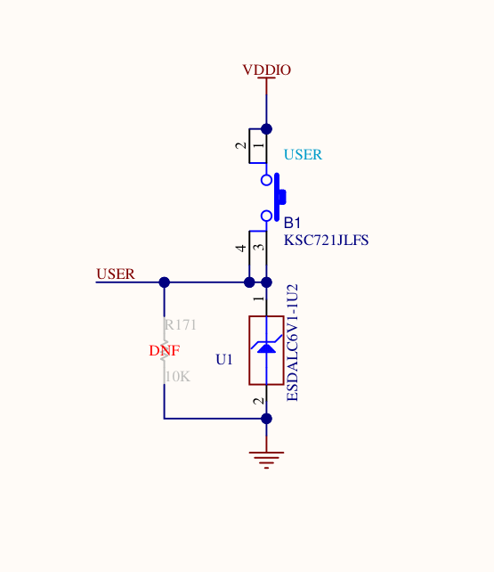

# Bare-Metal Button-Controlled LED Toggle (STM32 Nucleo-N657X0-Q)

## 📌 Overview

This project demonstrates toggling the built-in LED (PG8) using the built-in user button (PC13) on the STM32 Nucleo-N657X0-Q board using **bare-metal Embedded C**.

The application accesses GPIO peripheral registers directly through memory-mapped addresses, without using the STM32 HAL GPIO drivers.

## ⚙️ Hardware Details

### Button (PC13)
- Connected with a pull-down resistor, as specified in the board schematic.
- Configured as **GPIO input with pull-down**.
- Default state: LOW (`0`).
- When pressed: HIGH (`1`).

### LED (PG8)
- Connected to 3.3 V (VCC) through a resistor, as specified in the board schematic.
- Configured as **GPIO output, push-pull**.
- Initial output level: HIGH.
- Because the LED is wired to VCC, it is **active-low**:
  - PG8 LOW (`0`) → LED ON.
  - PG8 HIGH (`1`) → LED OFF.

## 🛠️ Implementation

1. Configure the system and enable the required GPIO peripheral clocks using direct register access.
2. Configure PC13 as a GPIO input with pull-down.
3. Configure PG8 as a push-pull GPIO output.
4. Initialize PG8 HIGH to keep the active-low LED OFF.
5. Poll PC13 by reading the GPIO input data register (`IDR`).
6. Detect a new button press and toggle the LED by writing to the GPIO bit set/reset register (`BSRR`).
7. Implement software debouncing using a simple delay loop and wait for the button to be released before detecting another press.

## 🔧 Bare-Metal Register Access

The implementation uses GPIO registers directly:

- `MODER` — configures each GPIO pin's mode.
- `PUPDR` — configures pull-up and pull-down resistors.
- `OTYPER` — selects push-pull or open-drain output.
- `IDR` — reads the input state of PC13.
- `BSRR` — sets or resets PG8 atomically.
- `RCC` — enables the required peripheral clocks.

Register addresses, clock-enable bits, and GPIO register availability must be taken from the **STM32N657 reference manual and CMSIS device headers**. The exact clock configuration must match the board's startup and system initialization requirements.

## 🚀 Learning Outcomes

- Direct memory-mapped peripheral register access.
- Bare-metal Embedded C programming without HAL GPIO functions.
- GPIO input and output configuration using `MODER`, `PUPDR`, and `OTYPER`.
- Reading input states using `IDR`.
- Setting and resetting output pins using `BSRR`.
- Active-low LED control and GPIO initialization.
- Button edge detection, polling, and software debouncing.
- Understanding the difference between register-level programming and HAL-based development.

## 🧪 Testing and Validation

1. Flash the bare-metal firmware to the STM32 Nucleo-N657X0-Q.
2. Confirm that the LED is initially OFF.
3. Press and release the button once; verify that the LED changes state.
4. Press and release the button again; verify that the LED returns to its previous state.
5. Test repeated presses to check that debouncing prevents unintended multiple toggles.
6. Inspect GPIO register values in the debugger to validate the configuration and output state.

## 📁 `STM32N657_BareMetal_GPIO_Button_LED_Toggle`

**Note:** This project intentionally avoids HAL GPIO APIs. CMSIS device definitions and startup code may still be used to access registers safely and initialize the MCU. Verify the board schematic and reference manual before relying on the stated pin wiring and clock configuration.

## 📸 Hardware Setup

## 📂 Repository Structure
