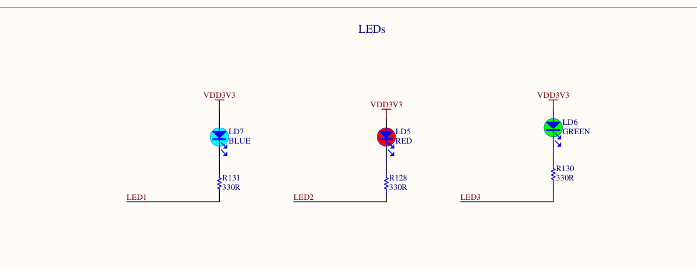

# Button-Controlled LED Toggle (STM32 Nucleo-N657X0-Q)

## 📌 Overview
This project demonstrates toggling the built-in LED (PG8) using the built-in user button (PC13) on the STM32 Nucleo-N657X0-Q board.

## ⚙️ Hardware Details
- **Button (PC13):**
  - Connected with a pull‑down resistor in the schematic.
  - Configured as **GPIO Input, Pull‑Down**.
  - Default state = LOW (0). When pressed, pin reads HIGH (1).

- **LED (PG8):**
  - Wired to **VCC (3.3V)** through a resistor.
  - Configured as **GPIO Output, Push‑Pull**.
  - Initial output level set to HIGH 

## 🛠️ Implementation
1. Initialize HAL and system clock.
2. Enable GPIO clocks for PC13 and PG8.
3. Configure PC13 as input (pull-down).
4. Configure PG8 as output (push-pull, initial HIGH).
5. In the main loop:
   - Read button state.
   - Toggle LED state on press.
   - Add debounce delay.

## 🚀 Learning Outcomes
- GPIO input with pull-down configuration.
- Active-low LED wiring and initialization.
- STM32 HAL GPIO setup.
- Debouncing techniques.

## 📸 Hardware Setup

## 📂 Repository Structure
